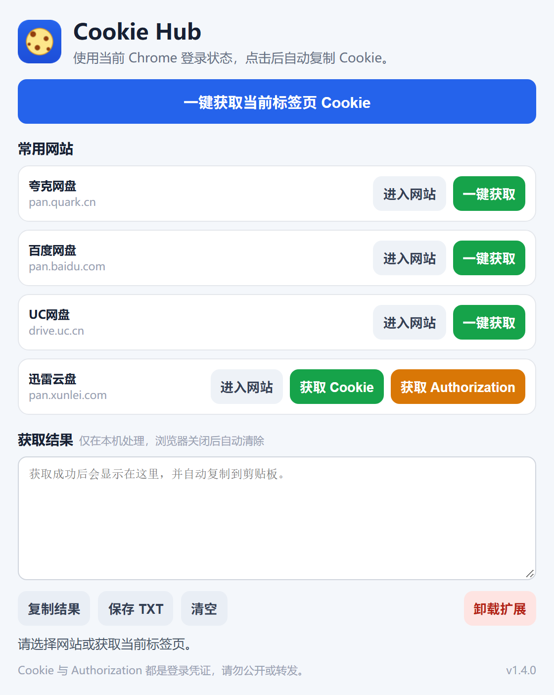

# Cookie Hub

一个使用电脑现有 Chrome 登录状态的 Cookie 获取扩展，适合需要 Cookie 或登录请求头的本地工具适配。

扩展只在你本机的 Chrome 里读取 Cookie，不会发起任何网络请求、不会上传或同步结果。



## 功能

- 获取当前网页 Cookie，获取成功后自动复制到剪贴板
- 支持夸克网盘、百度网盘、UC 网盘和迅雷云盘的快捷入口
- 迅雷云盘提供独立的“获取 Cookie”和“获取 Authorization”按钮
- 关闭弹窗后重新打开，会恢复本次浏览器会话中最后一次获取的结果
- 支持保存 TXT（保存为 `cookie-*.txt` 或 `authorization-*.txt`）
- 一键安装、一键卸载，扩展内也可直接卸载

## 安装

1. 双击 `一键安装.bat`，脚本会打开 Chrome 扩展页并复制扩展路径。
2. 在 Chrome 扩展页右上角开启“开发者模式”。
3. 点击“加载已解压的扩展程序”，选择 `chrome_extension` 文件夹。
4. 安装后把 Cookie Hub 固定到工具栏。

注意：加载完成后不要删除或移动 `chrome_extension` 文件夹，否则扩展会失效。

也可以直接打开 `chrome://extensions/` 手动加载 `chrome_extension` 文件夹。

## 使用

1. 在 Chrome 中打开并登录目标网站。
2. 点击 Cookie Hub 图标。
3. 普通网站点击“一键获取”；迅雷云盘按需要点击“获取 Cookie”或“获取 Authorization”。

结果会显示在弹窗中并自动复制，也可以点击“保存 TXT”保存到下载目录。

### 迅雷云盘

- “获取 Cookie”只读取当前登录状态，不刷新页面。
- “获取 Authorization”会刷新当前迅雷标签页，扩展通过调试器捕获页面请求中的 `Authorization` 请求头，捕获成功后立即断开调试连接；最多等待 25 秒，超时会自动取消并断开。

## 权限说明

| 权限 | 用途 |
| --- | --- |
| `cookies` | 读取当前网站的 Cookie |
| `tabs` | 读取当前标签页地址、打开常用网站 |
| `clipboardWrite` | 把结果自动复制到剪贴板 |
| `downloads` | 把结果保存为 TXT |
| `debugger` | 捕获迅雷页面请求中的 `Authorization` 请求头 |
| `storage` | 在本次浏览器会话中暂存结果，关闭浏览器即清除 |
| `<all_urls>` | 常用网站可能不是当前标签页，需要按网址读取对应 Cookie |

`debugger` 权限会让 Chrome 显示“Cookie Hub 已开始调试此浏览器”的提示，这是捕获请求头所必需的；捕获成功或超时后会自动断开。

## 隐私与安全

- Cookie 和 Authorization 只在本地处理，扩展没有任何网络请求代码。
- 结果仅保存在 `chrome.storage.session`（内存会话存储），浏览器关闭后自动清除，不写入磁盘。
- 保存的 TXT 会落在浏览器下载目录，请自行保管，不要提交到公开仓库。
- Cookie 和 Authorization 都是登录凭证，只能用于自己的账号；泄露后请立即退出对应网站的所有设备并重新登录。

## 常见问题

**没有读取到 Cookie**

请先在 Chrome 中登录该网站，并确认当前标签页就是目标网站。

**提示“当前迅雷标签页被其他扩展占用”**

另一个扩展（例如旧的 Authorization 获取扩展）占用了调试器。停用该扩展后，在 `chrome://extensions` 重新加载 Cookie Hub 再试。打开了该标签页的开发者工具也会占用调试器。

**未捕获到 Authorization**

确认已登录迅雷云盘、当前标签页仍是迅雷云盘、页面没有停在登录/验证页，然后重试。扩展会自动刷新页面，刷新后不要切换标签页。

**保存 TXT 没有反应**

确认安装时允许了“下载文件”权限；若 `downloads` 接口不可用，扩展会自动回退到页面内下载。

**扩展失效或图标消失**

`chrome_extension` 文件夹被移动或删除后扩展会失效，请重新加载该文件夹。

## 开发与检查

```powershell
python -m unittest -v test_extension
node --check chrome_extension/background.js
node --check chrome_extension/popup.js
```

生成图标（需要 Pillow）：

```powershell
python tools/make_icons.py
```

在真实 Chrome 中做冒烟检查（会加载扩展、校验 Cookie/下载/会话存储接口，并刷新 `docs/popup.png`）：

```powershell
node tools/smoke_chrome.mjs
```

品牌版 Chrome 会忽略命令行 `--load-extension`，脚本改用 CDP 的 `Extensions.loadUnpacked`（需要带 `--remote-debugging-pipe` 和 `--enable-unsafe-extension-debugging` 启动）加载扩展。

打包（输出到 `dist/`，`manifest.json` 位于 zip 根目录，可直接用于分发）：

```powershell
python tools/build_package.py
```

GitHub Actions 会在每次 push 和 PR 时执行上述检查并上传打包产物。

## 目录结构

```text
chrome_extension/      扩展源码（manifest、popup、background、图标）
tools/make_icons.py    图标生成脚本
tools/build_package.py 打包脚本
tools/smoke_chrome.mjs 真实 Chrome 冒烟检查
docs/popup.png         界面截图（由冒烟脚本生成）
test_extension.py      静态检查与行为约束测试
一键安装.bat            双击安装
一键卸载.bat            双击卸载
```

## 版本

当前版本 1.4.0，变更记录见 [CHANGELOG.md](CHANGELOG.md)。

## 许可证

MIT License
